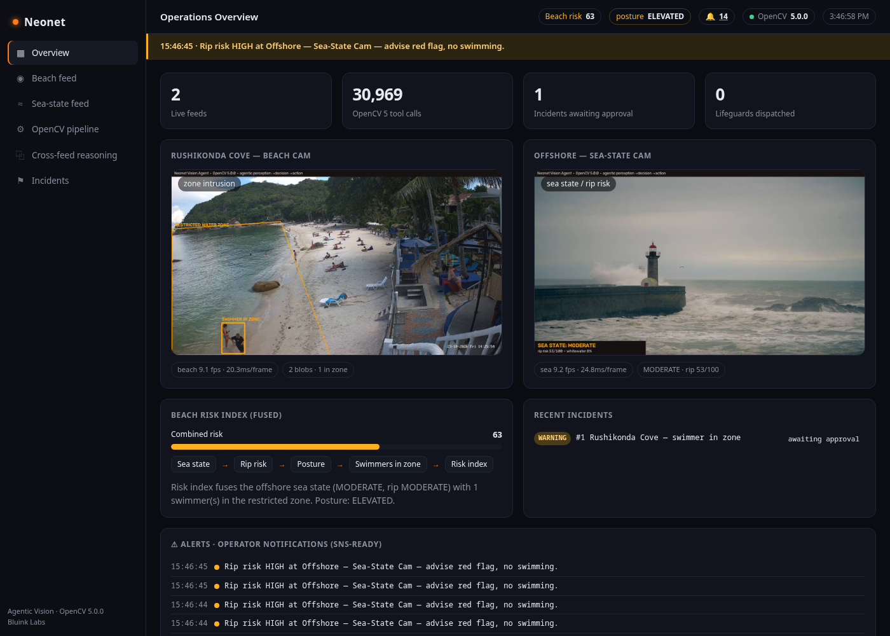
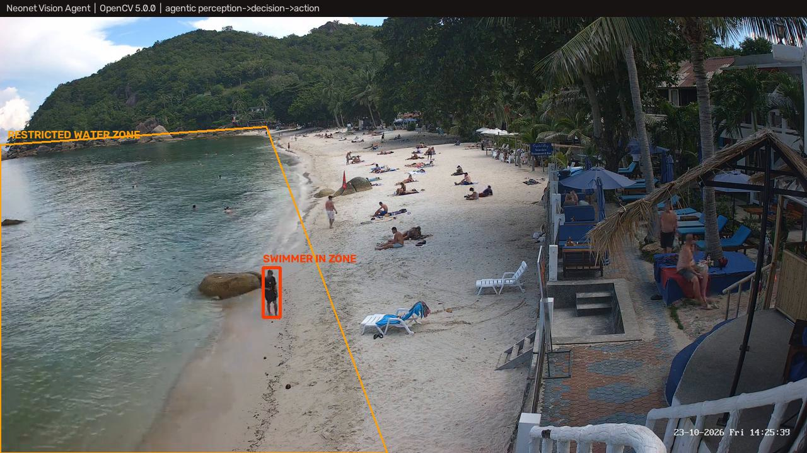
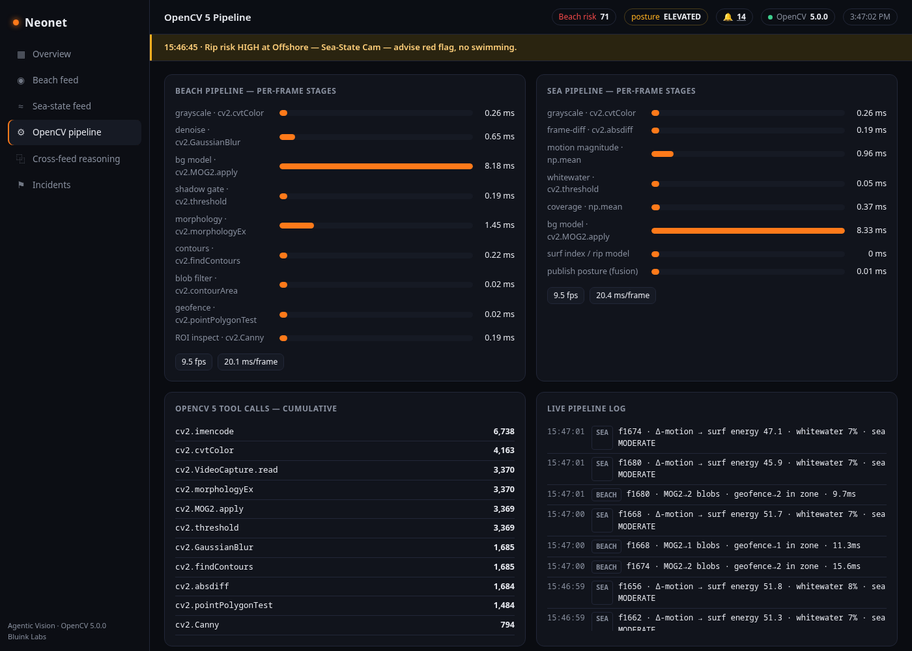

# Neonet Vision Agent

> **OpenCV AI Competition 2026 — Agentic Vision Award**
> An agentic coastal-safety system built on **OpenCV 5**. Built by [Bluink Labs](https://bluinklabs.com).

An autonomous vision agent watches two live camera feeds, reasons over them with
**OpenCV 5** tools, fuses the two feeds into a single risk picture, and escalates
confirmed hazards to a human operator for approval. CPU-only — no GPU, no model
downloads. A focused spin-off of [Neonet](https://bluinklabs.com), Bluink Labs'
agentic vision intelligence platform for CCTV.



---

## Why it's an *agent*, not just a detector

On each feed, every tick, the agent calls **OpenCV 5 tools** — and the *visual
result of one tool decides the next tool call and the next action*:

| Step | OpenCV 5 | What it does |
|-----:|----------|--------------|
| 1 · perceive | `createBackgroundSubtractorMOG2` + `findContours` | segment moving objects in the scene |
| 2 · geofence | `pointPolygonTest` | is a blob's foot point inside the restricted water zone? |
| 3 · inspect | `Canny` on a cropped ROI | a **second** look, triggered only when 1–2 flag a blob — confirm a real swimmer vs. surf glint |
| 4 · decide + act | — | above the confidence gate → raise an incident, **request operator approval** |
| 5 · human | — | operator **approves** (dispatch lifeguard) or **dismisses** (false alarm) |

Only confirmed detections produce actions; surf glint (small area / wrong aspect
ratio) is rejected; a human is always in control before a dispatch.



---

## Two feeds, fused — *cross-feed reasoning*

- **Feed A — Beach cam:** geofenced water zone, swimmer-in-zone detection.
- **Feed B — Offshore sea-state cam:** surf energy (`absdiff` frame-differencing)
  + whitewater (`threshold`) → sea state + rip-risk score.

The offshore camera never sees a swimmer and the beach camera never measures the
surf. The agent **fuses** them into a **risk posture**: a swimmer entering the
restricted zone is *advisory* under a calm sea, but escalates to **CRITICAL** when
the sea-state feed reports rough water with high rip risk. One camera's visual
state changes how the agent acts on another's events.

---

## Where OpenCV 5 is doing the work

Every substantive operation runs on OpenCV 5.0.0, surfaced live in the dashboard's
**OpenCV pipeline** view — each stage labelled with its `cv2.*` function, timed per
frame, and counted (tens of thousands of calls within the first minute):

`cv2.VideoCapture` · `cv2.cvtColor` · `cv2.GaussianBlur` ·
`cv2.createBackgroundSubtractorMOG2` · `cv2.threshold` · `cv2.morphologyEx` ·
`cv2.findContours` · `cv2.contourArea` · `cv2.boundingRect` ·
`cv2.pointPolygonTest` · `cv2.Canny` · `cv2.absdiff` · `cv2.imencode`



---

## Quick start

> **This repo is the codebase only — it ships no video.** Drop two short `.mp4`
> clips into `media/` first (see [`media/README.md`](media/README.md)):
> `media/demo.mp4` (a **static** beach cam) and `media/demo2.mp4` (a sea / surf cam).

```bash
pip install -r requirements.txt
uvicorn app:app --host 0.0.0.0 --port 8010
# open http://localhost:8010
```

Or with Docker (copy your clips into `media/` before building):

```bash
docker build -t neonet-vision-agent .
docker run -p 8010:8010 neonet-vision-agent
```

Give the agent ~30–60 s to warm up its background model, then a swimmer entering
the zone is raised as an incident awaiting your approval on the **Incidents** page.

### Headless self-test (no browser)

```bash
python selftest.py            # verifies OpenCV 5.x + both pipelines on feeds.json
python selftest.py my.mp4     # test one clip as a beach feed
```

---

## Add / change feeds

Feeds are defined in [`feeds.json`](feeds.json). Drop an `.mp4` in `media/` and add
an entry:

```json
{
  "id": "mybeach",
  "name": "My Beach — Cam 1",
  "kind": "beach",                       // "beach" (zone intrusion) or "sea" (sea state)
  "video": "media/your_clip.mp4",
  "zone_frac": [[0.0,0.3],[0.4,0.3],[0.5,1.0],[0.0,1.0]]
}
```

- `kind: "beach"` — people / restricted-zone detection. `zone_frac` is the restricted
  polygon as `[x,y]` pairs in `0..1` fractions of the frame (x → right, y → down);
  omit it for a default zone. **Use a static camera** — background subtraction needs
  a fixed viewpoint; handheld/panning footage registers as motion everywhere.
- `kind: "sea"` — sea-state / rip-risk estimation (no zone needed).

The **Overview / Beach / Sea** pages expect feeds with ids `beach` and `sea` (swap
their `video` paths to your own clips); any extra feeds also appear in the pipeline
and incidents views. A missing video is skipped with a log line — the app still starts.

---

## AWS

Single CPU container, designed for AWS:

- **Image** → Amazon ECR.
- **Compute** → EC2 (t3.large) or ECS/Fargate; operator console behind an ALB.
- **Alerts** → the alert stream (rip-risk warnings, confirmed incidents, dispatch
  confirmations) is **SNS-ready**.
- **Audit** → incidents + the agent's reasoning trace are emitted as JSON (`/state`)
  for S3 / CloudWatch.

---

## Operator console

Six views: **Overview**, **Beach feed**, **Sea-state feed**, **OpenCV pipeline**,
**Cross-feed reasoning**, **Incidents** — live annotated video, the agent's reasoning
trace, OpenCV telemetry, an alert bar, and the human approve/dismiss controls.

## Project layout

| File | Purpose |
|------|---------|
| `app.py` | agent loop, OpenCV 5 pipeline, FastAPI server |
| `ui.html` | the operator console (6 views, no build step) |
| `feeds.json` | feed configuration — add your own here |
| `selftest.py` | headless OpenCV 5 + pipeline check |
| `Dockerfile`, `requirements.txt` | container + pinned deps (OpenCV 5) |
| `media/` | put your `.mp4` clips here (not committed) |

## Stack

**Languages:** Python · HTML · CSS · JavaScript · JSON
**Libraries:** OpenCV 5 (`opencv-python 5.0.0`) · FastAPI · Uvicorn · NumPy
**Deploy:** Docker · AWS (ECR, EC2/Fargate, SNS, S3/CloudWatch)

Built by Bluink Labs.
